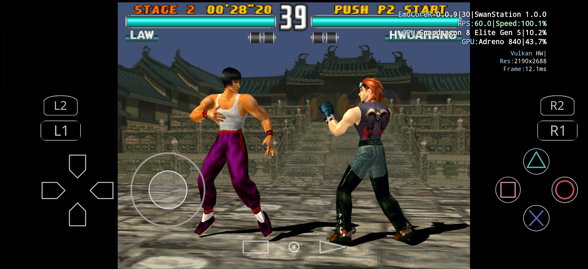
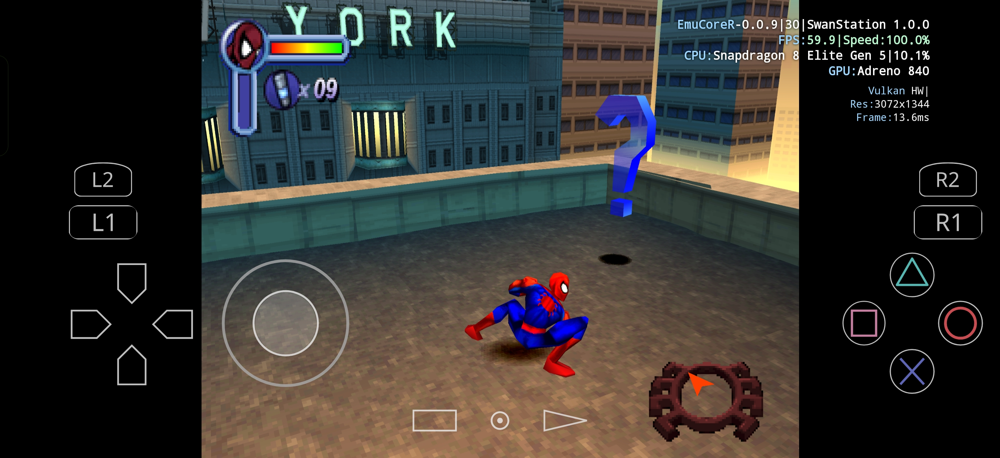
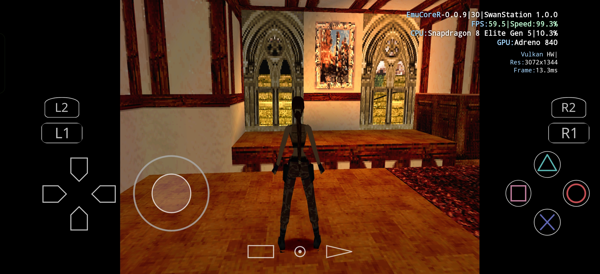
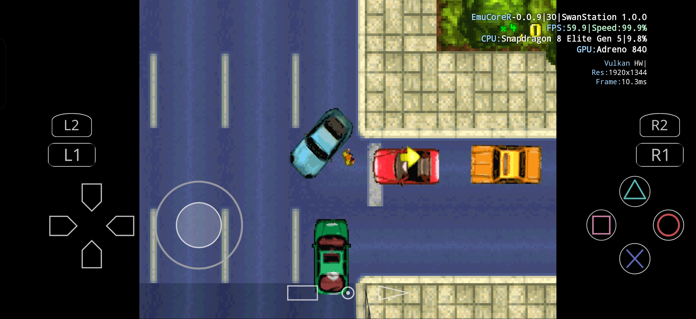

# EmuCoreR

[](https://emucorer.web.app)
[](https://play.google.com/store/apps/details?id=com.sbro.emucorer)
[](https://discord.com/invite/c5EBeNRpz2)
[](https://www.patreon.com/c/emucore/membership)

EmuCoreR is a PlayStation 1 emulator and game library for Android, built around the **ECR (`libecr`)** PlayStation 1 emulation core (derived from [SwanStation](https://github.com/libretro/swanstation)) paired with both a Jetpack Compose frontend and a dedicated native OpenGL ES 3.0 PlayStation 1 BIOS shell for phones, tablets, and handheld consoles.

## Website and Releases

Builds are published on the project website at **[emucorer.web.app](https://emucorer.web.app)**. Every release includes localized release notes in all 18 app languages and per-file download links backed by Cloud Firestore, and updates can be opened directly inside the app.

- Website: https://emucorer.web.app
- Google Play: https://play.google.com/store/apps/details?id=com.sbro.emucorer
- Changelogs and downloads: https://emucorer.web.app/#downloads
- Community: https://discord.com/invite/c5EBeNRpz2

## Highlights

- **ECR (`libecr`) PlayStation 1 core** (derived from [SwanStation](https://github.com/libretro/swanstation)) with ARM64 CPU Recompiler/JIT, Cached Interpreter, and Interpreter modes
- **Dual 4 KiB & 16 KiB Android page-size native builds** (`libecr_android.so` / `libecr_android_16k.so`) for full Android 15/16 device compatibility
- **Vulkan, OpenGL ES 3.0, and Threaded Software renderers** with up to 16x internal resolution, texture filtering (Nearest, Bilinear, JINC2, xBR), and `librashader` post-processing shader chains
- **True color rendering, scaled dithering, deinterlacing, and PGXP** geometry precision, perspective-correct texturing, and depth buffer emulation
- **Native PlayStation 1 BIOS Shell (`:native-ui:android`)** rendered in C++17 / OpenGL ES 3.0 with a 2-act PlayStation 1 boot animation, floating 3D BIOS orbs, 5 BIOS themes (*Classic Blue*, *PSone Silver*, *Midnight OLED*, *Net Yaroze Black*, *Crimson Obsidian*), 15-block Memory Card quick-save browser with live CRT previews, and responsive handheld/tablet scaling for both touch and physical gamepads
- **Broad disc & audio format support**: CUE/BIN, ISO, IMG, CHD, PBP, ECM, MDS, PSF, ZIP/7Z/RAR archives, and multi-disc M3U playlists
- **Game library & organization**: SAF folder scanning, online/custom cover art, quick saves & save states with thumbnails, per-game graphics/controls/audio/memory-card profiles (with automatic migration of legacy core settings), cheats, and HD texture packs
- **Memory Card Manager** with slot assignment, per-game/dedicated cards, backup/restore, import, and export
- **RetroAchievements (`rcheevos`)**, **Discord Social SDK Rich Presence**, and **Hub** with PlayStation news, history, videos, and manuals
- **Full 18-language localization** across both the Compose UI and the Native PS1 BIOS Shell

## Screenshots

In-game captures running on a Snapdragon 8 Elite Gen 5 device with the Vulkan renderer:

| Tekken 3 | Spider-Man |
| --- | --- |
|  |  |

| Spyro the Dragon | Tomb Raider III |
| --- | --- |
|  |  |

| Grand Theft Auto |
| --- |
|  |

## What This Repository Contains

This repository contains the Android application, its Compose UI, the C++17 OpenGL ES 3.0 Native PS1 BIOS Shell module (`native-ui/android`), settings and data layers, the JNI `libecr` host (`app/src/main/cpp`), and the **ECR** PlayStation 1 emulation core (`core/ecr`, derived from [SwanStation](https://github.com/libretro/swanstation)).

## Tech Stack

- **Kotlin + Jetpack Compose** (`app/`) with adaptive phone/tablet/handheld shells
- **Native OpenGL ES 3.0 / C++17 UI** (`native-ui/android/`) powering the PlayStation 1 BIOS shell
- **ECR (`libecr`) PlayStation 1 core** (`core/ecr/`, derived from [SwanStation](https://github.com/libretro/swanstation)) with `dep/libecr-common`, `libchdr`, `vixl`, `miniz`, `openbios`, and dual `4K` / `16K` page-size builds
- **`librashader`** for hardware post-processing Slang shader chains on OpenGL ES and Vulkan
- **`rcheevos`** (`third_party/rcheevos`) for RetroAchievements tracking, achievement sets, and disc hashing
- **Android DataStore, Room, WorkManager, and Coil**
- **Discord Social SDK** (isolated `:discord` process) & **Firebase Hosting / Cloud Firestore**

## Current App Scope

EmuCoreR version `0.1.9` (`versionCode 56`) targets Android with:

- `minSdk 26` / `targetSdk 37` / `compileSdk 37` (minor API level 2)
- ABI: `arm64-v8a` (both 4 KiB and 16 KiB ELF/fastmem page-size support)
- package id: `com.sbro.emucorer`
- version: `0.1.9`

## Building Locally

### Requirements

- Android Studio with Android SDK, CMake `3.30.5`, and NDK `29.0.14206865`
- JDK 17+ compatible with AGP / Gradle
- Rust toolchain (only when building with `librashader` sources present)
- An `arm64-v8a` Android device for on-device runtime & hardware tests

### Debug Build & Unit Tests

```powershell
.\gradlew.bat :app:testDebugUnitTest :app:assembleDebug
```

### Release Build

```powershell
.\gradlew.bat :app:assembleRelease
```

## Project Structure

- `app/` — Android application module, Compose UI, settings/migration, game library, and JNI `libecr` host (`app/src/main/cpp`)
- `native-ui/android/` — Native C++17 / OpenGL ES 3.0 PlayStation 1 BIOS shell UI and synthesized PS1 audio engine
- `core/ecr/` — **ECR (`libecr`)** PlayStation 1 emulation core (derived from [SwanStation](https://github.com/libretro/swanstation)) and its in-tree dependencies (`dep/libecr-common`, `libchdr`, `vixl`, `openbios`, etc.)
- `third_party/rcheevos/` — Vendored [rcheevos](https://github.com/RetroAchievements/rcheevos) client for RetroAchievements
- `app/src/main/res/` — Resources and localized strings across 18 languages
- `app/src/main/assets/catalog/` — Bundled game catalog, cover art index, and PS1 serial/title database
- `tools/`, `tests/`, `testgames/` — Local build/verification/oracle scripts (ignored by git)

## Notes

- BIOS files and commercial game images are not distributed with this project. You must supply your own legally obtained BIOS dumps and game backups.
- Compatibility, performance, and graphical accuracy vary by device GPU driver and selected renderer (Vulkan, OpenGL ES, or Software).
- Releases marked as "parallel" use an alternate application ID to allow side-by-side installation.

## Credits

EmuCoreR's **ECR** core builds on the open-source [SwanStation](https://github.com/libretro/swanstation) and [DuckStation](https://github.com/stenzek/duckstation) projects, combined with EmuCoreR core adaptations, the JNI `libecr` host, the native OpenGL ES 3.0 PS1 BIOS shell, game library, runtime controls, and handheld-focused UX maintained by SBRO / Sashkin Apps.

Thanks to the SwanStation and DuckStation developers, the libretro team, the RetroAchievements team for `rcheevos`, the `librashader` project, and everyone who contributes to keeping PlayStation emulation open and alive.

## Support

If you want to support ongoing development:

- Website: https://emucorer.web.app
- Discord: https://discord.com/invite/c5EBeNRpz2
- Patreon: https://www.patreon.com/c/emucore/membership
- More apps by the author: https://play.google.com/store/apps/dev?id=7136622298887775989

## License

The bundled **ECR** emulation core derives from [SwanStation](https://github.com/libretro/swanstation), distributed under the GNU General Public License v3.0 or later (`GPL-3.0-or-later`). The core sources in `core/ecr`, including EmuCoreR adaptations, are published with the app at https://github.com/sashkinbro/EmuCoreR.

The EmuCoreR Android application code is distributed under its own terms.
