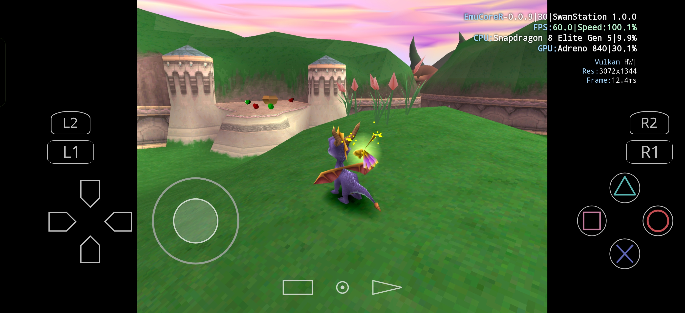

# EmuCoreR

[](https://emucorer.web.app)
[](https://play.google.com/store/apps/details?id=com.sbro.emucorer)
[](https://discord.com/invite/c5EBeNRpz2)
[](https://www.patreon.com/c/emucore/membership)

EmuCoreR is a PlayStation 1 emulator and game library for Android, built around the **ECR (`libecr`)** PlayStation 1 emulation core (derived from [SwanStation](https://github.com/libretro/swanstation)) paired with both a Jetpack Compose frontend and a dedicated native OpenGL ES 3.0 PlayStation 1 BIOS shell for phones, tablets, and handheld consoles.

## Website and Releases

Builds are published on the project website at **[emucorer.web.app](https://emucorer.web.app)**. Every release includes localized release notes in all 18 app languages and per-file download links backed by Cloud Firestore, and updates can be opened directly inside the app.

- Website: https://emucorer.web.app
- Google Play: https://play.google.com/store/apps/details?id=com.sbro.emucorer
- Changelogs and downloads: https://emucorer.web.app/#downloads
- Community: https://discord.com/invite/c5EBeNRpz2

## Highlights

- **ECR (`libecr`) PlayStation 1 core** (derived from [SwanStation](https://github.com/libretro/swanstation)) with ARM64 CPU Recompiler/JIT, Cached Interpreter, and Interpreter modes
- **Dual 4 KiB & 16 KiB Android page-size native builds** (`libecr_android.so` / `libecr_android_16k.so`) for full Android 15/16 device compatibility
- **Vulkan, OpenGL ES 3.0, and Threaded Software renderers** with up to 16x internal resolution, texture filtering (Nearest, Bilinear, JINC2, xBR), and `librashader` post-processing shader chains
- **True color rendering, scaled dithering, deinterlacing, and PGXP** geometry precision, perspective-correct texturing, and depth buffer emulation
- **Native PlayStation 1 BIOS Shell (`:native-ui:android`)** rendered in C++17 / OpenGL ES 3.0 with a 2-act PlayStation 1 boot animation, floating 3D BIOS orbs, 5 BIOS themes (*Classic Blue*, *PSone Silver*, *Midnight OLED*, *Net Yaroze Black*, *Crimson Obsidian*), 15-block Memory Card quick-save browser with live CRT previews, and responsive handheld/tablet scaling for both touch and physical gamepads
- **Broad disc & audio format support**: CUE/BIN, ISO, IMG, CHD, PBP, ECM, MDS, PSF, ZIP/7Z/RAR archives, and multi-disc M3U playlists
- **Game library & organization**: SAF folder scanning, online/custom cover art, quick saves & save states with thumbnails, per-game graphics/controls/audio/memory-card profiles (with automatic migration of legacy core settings), cheats, and HD texture packs
- **Memory Card Manager** with slot assignment, per-game/dedicated cards, backup/restore, import, and export
- **RetroAchievements (`rcheevos`)**, **Discord Social SDK Rich Presence**, and **Hub** with PlayStation news, history, videos, and manuals
- **Full 18-language localization** across both the Compose UI and the Native PS1 BIOS Shell

## Screenshots

In-game captures running on a Snapdragon 8 Elite Gen 5 device with the Vulkan renderer:

| Tekken 3 | Spider-Man |
| --- | --- |
|  |  |

| Spyro the Dragon | Tomb Raider III |
| --- | --- |
|  |  |

| Grand Theft Auto |
| --- |
|  |

## ECR Core Performance & Accuracy Benchmarks

The **ECR (`libecr`)** core is verified against a hardware-locked suite of **109 CPU/GTE/DMA/MDEC/SMC accuracy oracle checks**, **60 GPU/PGXP rendering oracle checks** (Software vs. Threaded Software vs. OpenGL ES 3.0 vs. Vulkan), and **3,088 PGXP unit assertions** (`0 failures`), alongside headless real-game benchmarks (`core/ecr/oracles/perf_bench.cpp`).

Key core & renderer optimizations include:
- **AArch64 JIT & Register Cache**: Fast dispatcher loop, `stp` caller-saved register pairing, `cls` leading-sign-bit emission, `ldrsb`/`ldrsh` sign-extending fastmem loads, negative-immediate constant folding, inline GTE register writes, and speculative constant tracking fixes.
- **GTE & PGXP Pipelines**: Compile-time templated `GTE::RTPS<pgxp_enable>` / `PushSZ<pgxp_enable>`, double-precision perspective projection (`double`), fused single-call JIT PGXP load-delay handling (`PGXP::CPU_LoadDelayAndUpdate`), and deferred end-of-instruction GTE arithmetic register synchronization (reducing per-command PGXP sync calls by 6x–12x).
- **GPU Backends & Threading**: Lock-free Dekker wake fast-path for the GPU worker thread, Vulkan/GLES pipeline & scissor state caching, GLES 4x4 Bayer dithering Y-flip parity fix (`99.94%` GL-vs-Vulkan exact match), fast non-wrapping VRAM texture hashing/decoding, and `std::fill_n` opaque span fast-paths in the Software renderer.
- **Clang ThinLTO (`-flto=thin`)**: Enabled across `libecr_android.so`, `libecr_android_16k.so`, `libemucorer_jni.so`, and `libemucorer_ps1ui.so` (`:native-ui:android`).

### 1. Tablet Benchmark — Lenovo Xiaoxin Pad Pro GT (`TB710FU`)
- **SoC / CPU**: Qualcomm Snapdragon 8 Gen 3 (Octa-core Cortex-X4 / A720 / A520)
- **GPU**: Qualcomm Adreno 750

| Workload / Game | Mode & Renderer | Baseline (FPS) | Pre-LTO Optimized (FPS) | Final with ThinLTO (FPS) | Total Gain |
| :--- | :--- | :---: | :---: | :---: | :---: |
| **Synthetic GTE 3D + PGXP** | `JIT_MMap` • Software (1x) | 1832.4 | 2002.6 | **2070.5** | **+13.0%** |
| **Synthetic GTE 3D + PGXP** | `JIT_PGXP_Mem` • Software (1x) | 1830.6 | 2003.3 | **2107.1** | **+15.1%** |
| **Synthetic GTE 3D + PGXP** | `JIT_PGXP_CPU` • Software (1x) | 1848.7 | 2002.2 | **2108.7** | **+14.1%** |
| **PS1 BIOS Boot (`scph101`)** | `JIT_MMap` • Software (1x) | 1678.1 | 2062.0 | **2274.1** | **+35.5%** |
| **PS1 BIOS Boot (`scph101`)** | `JIT_MMap` • OpenGL ES 3.0 (1x) | 1651.9 | 2007.8 | **2171.5** | **+31.5%** |
| **PS1 BIOS Boot (`scph101`)** | `JIT_MMap` • Vulkan (1x) | 1412.8 | 1693.5 | **1883.0** | **+33.3%** |
| **PS1 BIOS Boot (`scph101`)** | `JIT_PGXP_CPU` • Vulkan (2x) | 459.8 | 789.4 | **746.4** | **+62.3%** |
| **Crash Bandicoot 2** | `JIT_PGXP_Mem` • OpenGL ES 3.0 (2x) | 541.0 | 934.5 | **956.4** | **+76.8%** |
| **Crash Bandicoot 2** | `JIT_PGXP_CPU` • OpenGL ES 3.0 (2x) | 439.5 | 664.1 | **688.9** | **+56.7%** |
| **Crash Bandicoot 2** | `JIT_PGXP_CPU` • Vulkan (2x) | 385.6 | 574.2 | **602.7** | **+56.3%** |
| **Dragon Ball GT: Final Bout** | `JIT_MMap` • Software Threaded (1x) | 917.2 | 957.6 | **1003.4** | **+9.4%** |
| **Dragon Ball GT: Final Bout** | `JIT_PGXP_Mem` • OpenGL ES 3.0 (2x) | 471.8 | 687.3 | **742.0** | **+57.3%** |
| **Dragon Ball GT: Final Bout** | `JIT_PGXP_CPU` • OpenGL ES 3.0 (2x) | 419.4 | 539.7 | **579.0** | **+38.1%** |
| **Dragon Ball GT: Final Bout** | `JIT_PGXP_CPU` • Vulkan (2x) | 389.9 | 471.3 | **515.6** | **+32.2%** |
| **Tekken 3** | `JIT_MMap` • Software Threaded (1x) | 466.8 | 1197.3 | **1292.3** | **+176.8%** |
| **Tekken 3** | `JIT_MMap` • OpenGL ES 3.0 (1x) | 1295.9 | 1371.0 | **1413.4** | **+9.1%** |
| **Tekken 3** | `JIT_PGXP_Mem` • OpenGL ES 3.0 (2x) | 515.5 | 795.9 | **805.0** | **+56.2%** |
| **Tekken 3** | `JIT_PGXP_CPU` • OpenGL ES 3.0 (2x) | 378.5 | 494.8 | **543.3** | **+43.5%** |
| **Tekken 3** | `JIT_PGXP_CPU` • Vulkan (2x) | 371.4 | 463.2 | **491.6** | **+32.4%** |

### 2. Handheld Console Benchmark — Anbernic RG556
- **SoC / CPU**: Unisoc T820 (Octa-core 1x Cortex-A76 @ 2.7 GHz + 3x Cortex-A76 @ 2.3 GHz + 4x Cortex-A55 @ 2.1 GHz)
- **GPU**: ARM Mali-G57 MC4 @ 850 MHz

| Workload / Game | Mode & Renderer | Baseline (FPS) | Pre-LTO Optimized (FPS) | Final with ThinLTO (FPS) | Total Gain |
| :--- | :--- | :---: | :---: | :---: | :---: |
| **Synthetic GTE 3D + PGXP** | `JIT_MMap` • Software (1x) | 880.4 | 1052.0 | **1083.8** | **+23.1%** |
| **Synthetic GTE 3D + PGXP** | `JIT_PGXP_Mem` • Software (1x) | 889.0 | 1045.1 | **1084.6** | **+22.0%** |
| **Synthetic GTE 3D + PGXP** | `JIT_PGXP_CPU` • Software (1x) | 887.0 | 1041.3 | **1083.6** | **+22.2%** |
| **PS1 BIOS Boot (`scph101`)** | `JIT_MMap` • Software (1x) | 970.4 | 1072.8 | **1189.5** | **+22.6%** |
| **PS1 BIOS Boot (`scph101`)** | `JIT_MMap` • OpenGL ES 3.0 (1x) | 989.5 | 1042.2 | **1121.2** | **+13.3%** |
| **PS1 BIOS Boot (`scph101`)** | `JIT_MMap` • Vulkan (1x) | 667.9 | 738.9 | **801.5** | **+20.0%** |
| **PS1 BIOS Boot (`scph101`)** | `JIT_PGXP_CPU` • Vulkan (2x) | 198.3 | 321.1 | **320.1** | **+61.4%** |
| **Crash Bandicoot 2** | `JIT_MMap` • Software (1x) | 841.3 | 850.5 | **911.2** | **+8.3%** |
| **Crash Bandicoot 2** | `JIT_MMap` • OpenGL ES 3.0 (1x) | 750.3 | 746.1 | **817.5** | **+9.0%** |
| **Crash Bandicoot 2** | `JIT_MMap` • OpenGL ES 3.0 (2x) | 764.4 | 775.4 | **823.6** | **+7.7%** |
| **Crash Bandicoot 2** | `JIT_PGXP_Mem` • OpenGL ES 3.0 (2x) | 319.0 | 439.3 | **417.8** | **+31.0%** |
| **Crash Bandicoot 2** | `JIT_PGXP_CPU` • OpenGL ES 3.0 (2x) | 254.8 | 345.8 | **330.3** | **+29.6%** |
| **Crash Bandicoot 2** | `JIT_PGXP_CPU` • Vulkan (2x) | 194.2 | 256.2 | **251.4** | **+29.5%** |
| **Dragon Ball GT: Final Bout** | `JIT_MMap` • Software (1x) | 439.9 | 429.7 | **462.9** | **+5.2%** |
| **Dragon Ball GT: Final Bout** | `JIT_MMap` • OpenGL ES 3.0 (1x) | 380.4 | 380.1 | **404.5** | **+6.3%** |
| **Dragon Ball GT: Final Bout** | `JIT_PGXP_Mem` • OpenGL ES 3.0 (2x) | 223.7 | 272.3 | **284.4** | **+27.1%** |
| **Dragon Ball GT: Final Bout** | `JIT_PGXP_CPU` • OpenGL ES 3.0 (2x) | 189.7 | 222.5 | **230.6** | **+21.6%** |
| **Dragon Ball GT: Final Bout** | `JIT_PGXP_CPU` • Vulkan (2x) | 153.7 | 175.5 | **196.7** | **+28.0%** |
| **Tekken 3** | `JIT_MMap` • Software (1x) | 635.0 | 621.8 | **655.2** | **+3.2%** |
| **Tekken 3** | `JIT_MMap` • OpenGL ES 3.0 (2x) | 578.5 | 564.1 | **596.5** | **+3.1%** |
| **Tekken 3** | `JIT_PGXP_Mem` • OpenGL ES 3.0 (2x) | 277.6 | 347.3 | **342.7** | **+23.5%** |
| **Tekken 3** | `JIT_PGXP_CPU` • OpenGL ES 3.0 (2x) | 211.3 | 250.5 | **260.8** | **+23.4%** |
| **Tekken 3** | `JIT_PGXP_CPU` • Vulkan (2x) | 209.0 | 251.6 | **260.8** | **+24.8%** |

## What This Repository Contains

This repository contains the Android application, its Compose UI, the C++17 OpenGL ES 3.0 Native PS1 BIOS Shell module (`native-ui/android`), settings and data layers, the JNI `libecr` host (`app/src/main/cpp`), and the **ECR** PlayStation 1 emulation core (`core/ecr`, derived from [SwanStation](https://github.com/libretro/swanstation)).

## Tech Stack

- **Kotlin + Jetpack Compose** (`app/`) with adaptive phone/tablet/handheld shells
- **Native OpenGL ES 3.0 / C++17 UI** (`native-ui/android/`) powering the PlayStation 1 BIOS shell
- **ECR (`libecr`) PlayStation 1 core** (`core/ecr/`, derived from [SwanStation](https://github.com/libretro/swanstation)) with `dep/libecr-common`, `libchdr`, `vixl`, `miniz`, `openbios`, and dual `4K` / `16K` page-size builds
- **`librashader`** for hardware post-processing Slang shader chains on OpenGL ES and Vulkan
- **`rcheevos`** (`third_party/rcheevos`) for RetroAchievements tracking, achievement sets, and disc hashing
- **Android DataStore, Room, WorkManager, and Coil**
- **Discord Social SDK** (isolated `:discord` process) & **Firebase Hosting / Cloud Firestore**

## Current App Scope

EmuCoreR version `0.1.9` (`versionCode 57`) targets Android with:

- `minSdk 26` / `targetSdk 37` / `compileSdk 37` (minor API level 2)
- ABI: `arm64-v8a` (both 4 KiB and 16 KiB ELF/fastmem page-size support)
- package id: `com.sbro.emucorer`
- version: `0.1.9`

## Building Locally

### Requirements

- Android Studio with Android SDK, CMake `3.30.5`, and NDK `29.0.14206865`
- JDK 17+ compatible with AGP / Gradle
- Rust toolchain (only when building with `librashader` sources present)
- An `arm64-v8a` Android device for on-device runtime & hardware tests

### Debug Build & Unit Tests

```powershell
.\gradlew.bat :app:testDebugUnitTest :app:assembleDebug
```

### Release Build

```powershell
.\gradlew.bat :app:assembleRelease
```

## Project Structure

- `app/` — Android application module, Compose UI, settings/migration, game library, and JNI `libecr` host (`app/src/main/cpp`)
- `native-ui/android/` — Native C++17 / OpenGL ES 3.0 PlayStation 1 BIOS shell UI and synthesized PS1 audio engine
- `core/ecr/` — **ECR (`libecr`)** PlayStation 1 emulation core (derived from [SwanStation](https://github.com/libretro/swanstation)) and its in-tree dependencies (`dep/libecr-common`, `libchdr`, `vixl`, `openbios`, etc.)
- `third_party/rcheevos/` — Vendored [rcheevos](https://github.com/RetroAchievements/rcheevos) client for RetroAchievements
- `app/src/main/res/` — Resources and localized strings across 18 languages
- `app/src/main/assets/catalog/` — Bundled game catalog, cover art index, and PS1 serial/title database
- `tools/`, `tests/`, `testgames/` — Local build/verification/oracle scripts (ignored by git)

## Notes

- BIOS files and commercial game images are not distributed with this project. You must supply your own legally obtained BIOS dumps and game backups.
- Compatibility, performance, and graphical accuracy vary by device GPU driver and selected renderer (Vulkan, OpenGL ES, or Software).
- Releases marked as "parallel" use an alternate application ID to allow side-by-side installation.

## Credits

EmuCoreR's **ECR** core builds on the open-source [SwanStation](https://github.com/libretro/swanstation) and [DuckStation](https://github.com/stenzek/duckstation) projects, combined with EmuCoreR core adaptations, the JNI `libecr` host, the native OpenGL ES 3.0 PS1 BIOS shell, game library, runtime controls, and handheld-focused UX maintained by SBRO / Sashkin Apps.

Thanks to the SwanStation and DuckStation developers, the libretro team, the RetroAchievements team for `rcheevos`, the `librashader` project, and everyone who contributes to keeping PlayStation emulation open and alive.

## Support

If you want to support ongoing development:

- Website: https://emucorer.web.app
- Discord: https://discord.com/invite/c5EBeNRpz2
- Patreon: https://www.patreon.com/c/emucore/membership
- More apps by the author: https://play.google.com/store/apps/dev?id=7136622298887775989

## License

The bundled **ECR** emulation core derives from [SwanStation](https://github.com/libretro/swanstation), distributed under the GNU General Public License v3.0 or later (`GPL-3.0-or-later`). The core sources in `core/ecr`, including EmuCoreR adaptations, are published with the app at https://github.com/sashkinbro/EmuCoreR.

The EmuCoreR Android application code is distributed under its own terms.
